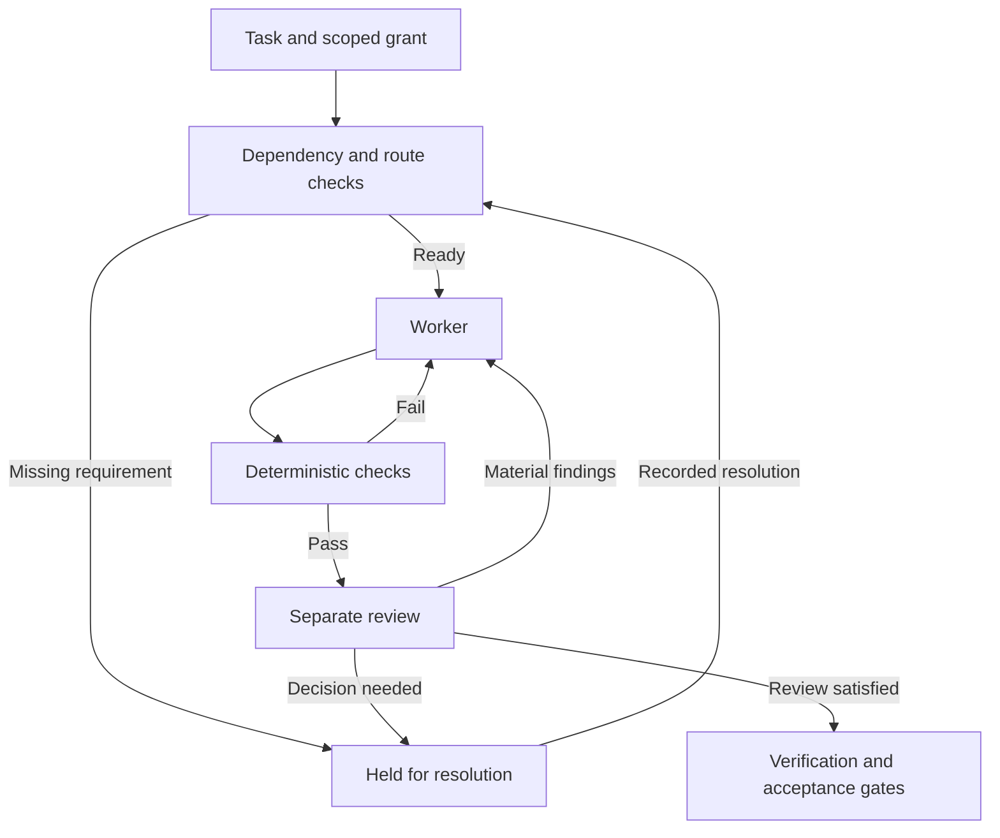

# Architecture and guarantees

Longform Orchestrator is a local controller with model adapters. Its durable records make long work inspectable and resumable. Its gates constrain how that work advances. Neither property eliminates the need for sound task design and human judgment.

## The control loop

This is a conceptual view, not a complete state-transition diagram. Proposal replies, advice, assessment, project checkpoints, cancellation, and reconciliation add their own records and gates.

## Main components

| Component | Responsibility |
| --- | --- |
| [`domain.ts`](../src/domain.ts) | Validated task/review schemas, operation types, path rules, digests, and core data structures. |
| [`controller.ts`](../src/controller.ts) | Task state, grants, dependencies, workspaces, evidence, review, verification, and acceptance. |
| [`store.ts`](../src/store.ts) | SQLite persistence, transactions, and event records. |
| [`orchestrator.ts`](../src/orchestrator.ts) | Durable requests, questions/replies, task bindings, and workflow advancement. |
| [`driver.ts`](../src/driver.ts), [`limits.ts`](../src/limits.ts), and [`claims.ts`](../src/claims.ts) | Built-in driving, provider-limit pauses, write claims, and uncertain-effect holds. |
| [`adaptive.ts`](../src/adaptive.ts) and [`evaluation.ts`](../src/evaluation.ts) | Evidence qualification, independent pair selection, durable routing pins, and evaluation journals. |
| [`screening.ts`](../src/screening.ts) | Optional discovery of owner decisions before task design and execution. |
| [`routing.ts`](../src/routing.ts) | Stakes, complexity tiers, explicit model routes, and route capability requirements. |
| [`project.ts`](../src/project.ts) and [`project-view.ts`](../src/project-view.ts) | Project membership, bounded project views, and checkpoints. |
| [`providers.ts`](../src/providers.ts) and [`live.ts`](../src/live.ts) | Provider protocol handling, identity/provenance, process execution, isolation, and capability attestation. |
| [`checks.ts`](../src/checks.ts), [`repo.ts`](../src/repo.ts), and [`drive.ts`](../src/drive.ts) | Output checks, pinned repository inputs, and scoped Drive access. |

## Durable state and explicit identity

The database preserves task specifications, attempts, receipts, evidence, grants, decisions, reviews, and workflow events. Requests bind to task specification digests. A later revision therefore cannot silently inherit an earlier request's review or completion claim.

Request keys provide idempotent submission behavior. Project keys explicitly associate related requests. Host identity distinguishes Codex, Claude, and the neutral operator role; a host cannot silently drive another host's owned request. The operator role has a different, deliberately broader local role.

Local operator authentication is based on the process's Unix UID. A `sourceRef` records provenance; it is not cryptographic proof that a particular human approved a statement in a conversation. The system assumes the operator and host configuration are trusted. This is not a multi-tenant authorization service.

The event chain provides an integrity check within the local record system. It is not an externally notarized, tamper-proof audit log against a privileged local user.

## Evidence and review

Evidence includes its origin, revision, digest, currentness, and relevant claims. A source that mentions a test result is documentary evidence of that claim, not a receipt proving this controller executed the test.

Reviews bind to the specification and artifact under review. Provider/session provenance supports separation from authorship. High-risk or consequential work can require independent cross-provider review and accuracy/local-drift/macro-drift audit assessments.

The controller can reject mismatched, stale, missing, or structurally invalid records. It cannot prove that every source is true or that a reviewer understood the problem. A model's semantic judgment remains a model judgment, with limits that should be recorded.

## Execution and scope

The live runner uses Bubblewrap with isolated process/network contexts, a controlled workspace, explicit runtime mounts, and allowlisted network egress. Provider output is parsed as data. Test commands come from trusted operator configuration and run through the command runner.

Write-path rules are checked against the resulting workspace snapshot. Within a writable worker workspace, path-level scope is not equivalent to a separate OS permission boundary for every permitted file. An out-of-scope change can be detected and rejected after a run. The sandbox and post-run checks serve different purposes.

Drive credentials stay with the host-side gateway. The gateway enforces per-task resource scope and records relevant reads/writes. Provider credentials are supplied to their intended provider runtime, and Codex may refresh its configured credential source. See [privacy and operations](privacy.md) before configuring accounts.

The controller blocks Git publication, deployment, hosted-database administration, and similar forbidden operations. Drive content writes are an intentional supported exception when specifically scoped and granted. A passing review is never a general permission to publish.

## Recovery and resource limits

An attempt can end successfully, fail, be cancelled, or leave its outcome unknown. Unknown effects require reconciliation before a retry can proceed. This matters especially when an external write may have happened before a process or connection failed.

Deadlines, attempt counts, cost/token accounting, context limits, and unresolved owner questions bound execution. Usage accounting relies on the provider information the adapter can establish; it is not a provider-side billing guarantee.

The controller is single-host and uses local SQLite. It is not a distributed job scheduler. Workflow advancement is driven by the CLI/host integration. The built-in `orchestrate --drive` command continues until its time budget ends or no request can advance, waiting for known provider reset times. It is a foreground driver, not an installed background service. See [current operation](current-workflow.md).

## Verification levels

Keep these conclusions separate:

1. **Build passes:** the TypeScript project compiles.
2. **Synthetic tests pass:** the tested controller behavior works under those fixtures and OS conditions.
3. **Sandbox probes pass:** specific isolation properties were observed in that environment.
4. **Route attestation passes:** a configured provider/model/effort was established for a bounded call at that time.
5. **Task review passes:** a reviewer judged the exact artifact against its contract.
6. **Task is accepted:** the controller's remaining evidence and decision requirements were satisfied.

None of these alone establishes all the others. Report the level actually verified and any skipped checks, missing access, or unresolved holds.

